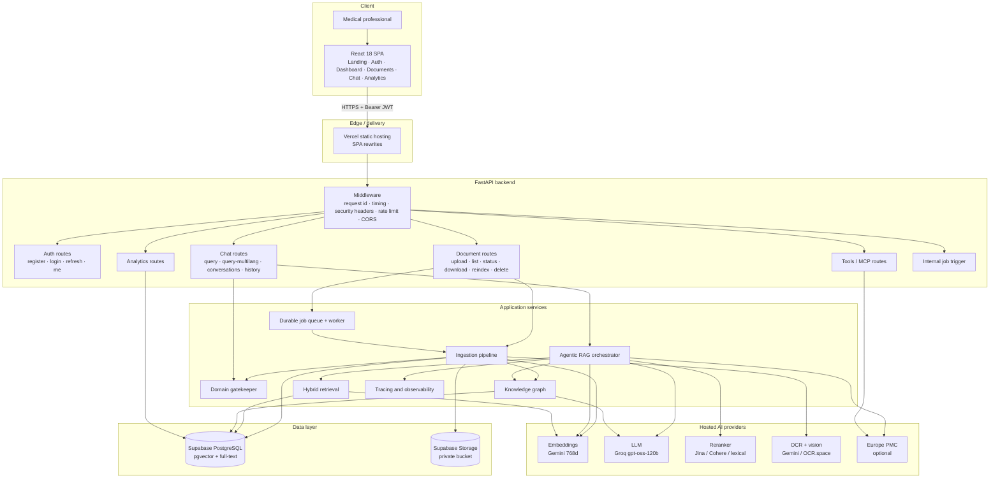
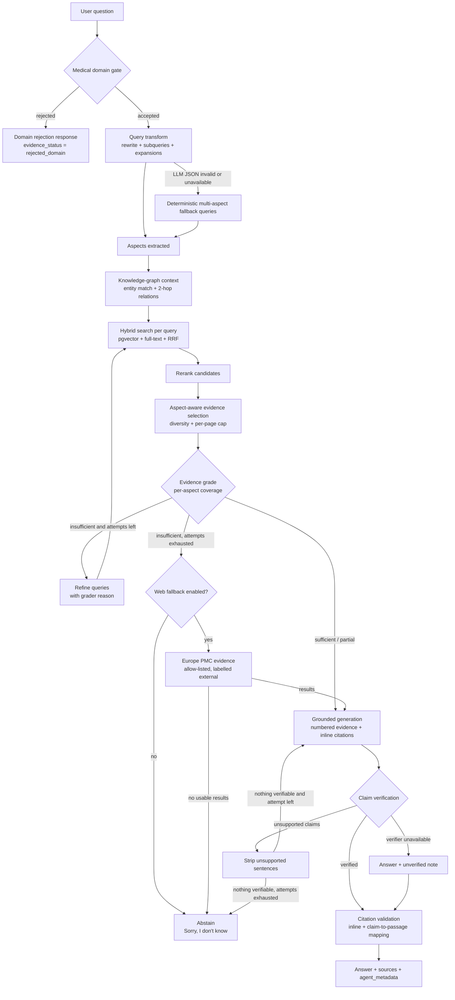
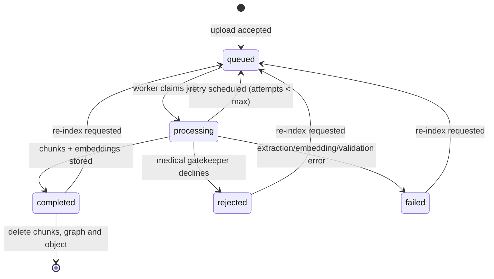
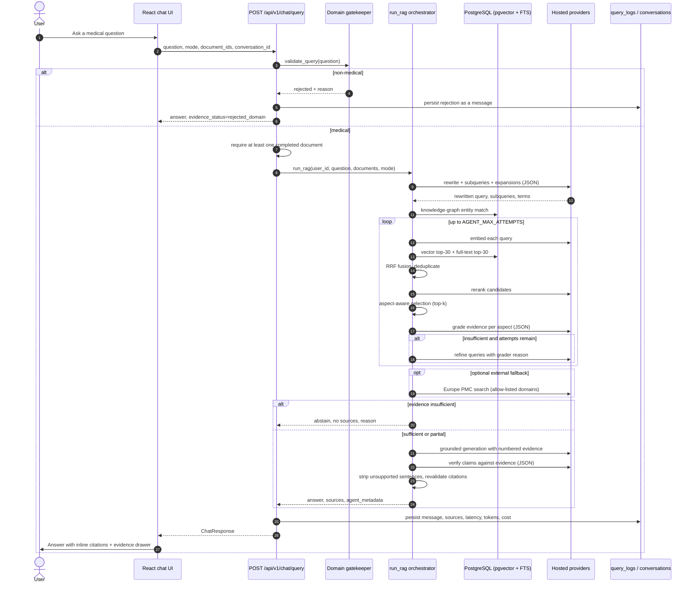
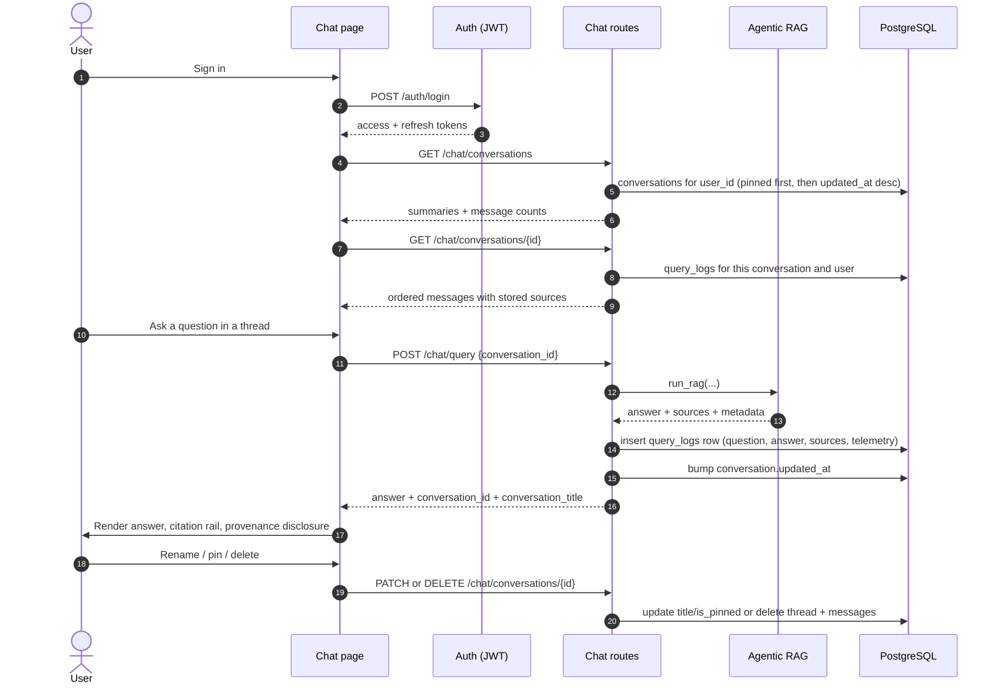
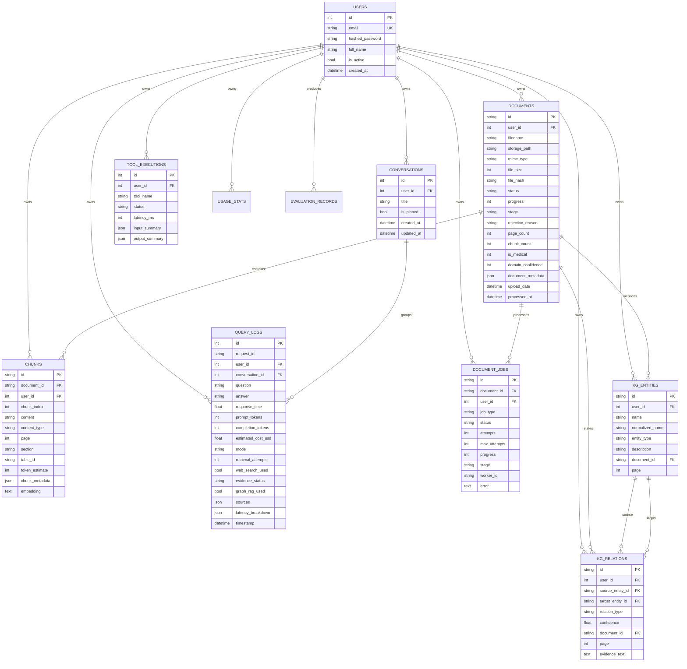
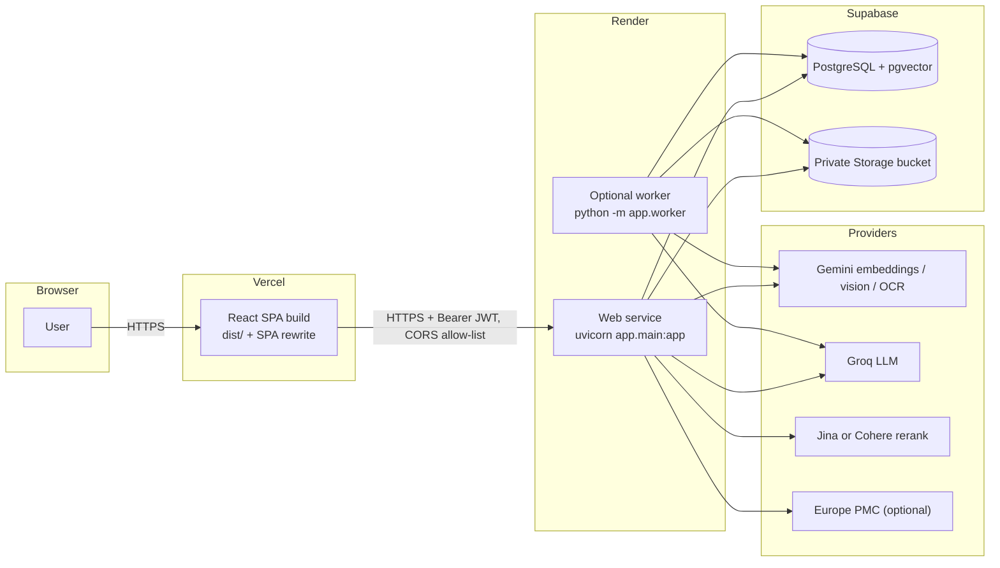

# MediQuery AI

### An Agentic RAG-Based Multi-Document Medical Knowledge Retrieval, Intelligence & Reasoning System

Intelligent medical knowledge retrieval powered by agentic AI and multi-document RAG — hybrid semantic + full-text search, evidence grading, corrective retrieval, claim-level verification and page-accurate citations over your own medical documents.

[](backend)
[](frontend)
[](backend/alembic)
[-F55036)](backend/app/providers/llm.py)
[](backend/app/providers/embeddings.py)
[](backend/tests)
[](backend/app/main.py)

**Repository:** <https://github.com/7wyk/MediQuery-AI---Agentic-Multi-Document-Medical-Knowledge-Retrieval-Reasoning-Intelligence-System>

> MediQuery AI supports medical professionals. It is **not** a medical device, does not diagnose or prescribe, and never replaces clinical judgement. Every answer is generated from retrieved evidence; when the evidence is insufficient the system abstains instead of guessing.

---

## Table of Contents

- [Executive Summary](#executive-summary)
- [Problem Statement](#problem-statement)
- [Key Features](#key-features)
- [Application Screenshots](#application-screenshots)
- [Technology Stack](#technology-stack)
- [System Architecture](#system-architecture)
- [Agentic AI Architecture](#agentic-ai-architecture)
- [RAG Architecture](#rag-architecture)
- [Multi-Document Processing Pipeline](#multi-document-processing-pipeline)
- [AI Query Processing Workflow](#ai-query-processing-workflow)
- [Conversational AI Workflow](#conversational-ai-workflow)
- [Database Architecture](#database-architecture)
- [Project Directory Structure](#project-directory-structure)
- [Getting Started](#getting-started)
- [Environment Variables](#environment-variables)
- [Development Commands](#development-commands)
- [API Documentation](#api-documentation)
- [Authentication and Security](#authentication-and-security)
- [Testing and Quality Assurance](#testing-and-quality-assurance)
- [Deployment Architecture](#deployment-architecture)
- [Error Handling and Reliability](#error-handling-and-reliability)
- [Engineering Highlights](#engineering-highlights)
- [Current Limitations](#current-limitations)
- [Future Roadmap](#future-roadmap)
- [Contributing](#contributing)
- [License](#license)
- [Acknowledgements](#acknowledgements)

---

## Executive Summary

MediQuery AI is a full-stack, cloud-oriented retrieval-augmented generation (RAG) application for medical documents. A user uploads clinical guidelines, drug references, first-aid procedures or scanned pages; the system extracts and indexes their text, tables and chart descriptions, then answers natural-language questions **only from that evidence**, citing the document, page and content type behind every claim.

The problem it addresses is not "can an LLM answer a medical question" but "can an LLM answer it *from a specific set of documents*, prove where each statement came from, and refuse when the documents do not contain the answer". General-purpose chatbots fail all three tests: they answer from parametric memory, cannot attribute a sentence to page 14 of a specific PDF, and rarely abstain. MediQuery AI is built around that gap.

Its primary users are medical professionals and students working with a private corpus of guidelines and references. Every account is a single unified type with no doctor/student roles, and every document, chunk, conversation and analytics row is scoped to the authenticated `user_id`.

**The core technical claim of this project is a self-correcting retrieval pipeline, not a prompt.** Query rewriting with a deterministic fallback, hybrid pgvector + PostgreSQL full-text retrieval fused by Reciprocal Rank Fusion, hosted reranking, aspect-aware evidence grading, bounded corrective retries with genuinely different queries, optional trusted external fallback, grounded generation, claim-level verification that removes unsupported sentences, and deterministic abstention. Around that pipeline sit a durable database-backed job queue, a medical-domain gatekeeper for both uploads and questions, a per-user medical knowledge graph, structured observability with token/cost accounting, and a reproducible offline evaluation harness.

Agentic RAG matters here because medical questions are compound ("what is hypertension and what causes it?") and retrieval is fallible. A single retrieve-then-generate pass silently degrades on multi-part questions and on vocabulary mismatch ("HTN" vs "hypertension"). MediQuery AI decomposes the question, retrieves per aspect, *grades* whether the retrieved passages actually support each aspect, and — when they do not — rewrites and retries within a configured budget before deciding to answer partially or abstain.

---

## Problem Statement

Medical knowledge is distributed across long, structured, heterogeneous documents: multi-hundred-page guidelines with tables of drug doses, scanned hospital protocols, spreadsheets of lab ranges, charts of blood-pressure trends. Four practical difficulties follow.

1. **Retrieval is not keyword search.** Clinicians ask in abbreviations and synonyms; documents use formal terminology. Lexical search misses paraphrases, while pure vector search loses exact numbers, drug names and codes. Neither alone is sufficient.
2. **Structure carries meaning.** A dose belongs to a table row and a page; a blood-pressure target belongs to a specific recommendation. Flattening a PDF into undifferentiated text destroys the metadata that makes a citation trustworthy.
3. **Multi-part questions need multi-part evidence.** A question about managing hypertension in a diabetic patient requires evidence from two different documents. Ranking passages against the *whole* question under-serves one of its parts.
4. **Fluency is not grounding.** An LLM will produce a confident, well-formatted, unsupported answer. Without verification and an explicit abstention path, a RAG system converts "I don't know" into a plausible hallucination.

MediQuery AI addresses these with structure-preserving ingestion, hybrid retrieval with rank fusion, aspect-aware evidence selection and grading, citation verification against the passages actually retrieved, and abstention as a first-class outcome rather than an error.

---

## Key Features

### Implemented

| Area | Feature | Where |
|---|---|---|
| Authentication | Email/password registration and login; bcrypt hashing; JWT access (60 min) + refresh (7 days) tokens; `/auth/me` profile | `backend/app/routes/auth.py`, `backend/app/services/auth.py` |
| Authorization | Every document, chunk, conversation, query log and graph row is filtered by the authenticated user; cross-user access returns 404, not 403 | `backend/app/routes/documents.py`, `backend/app/routes/chat.py` |
| Ingestion | Multi-file upload (up to 5 per request), 25 MB per file, magic-byte type detection (extension never trusted) | `backend/app/services/extraction.py` |
| Formats | PDF (text and scanned), DOCX, XLSX, CSV, TXT, JPG/JPEG, PNG | `backend/app/services/extraction.py` |
| Multimodal extraction | Tables keep headers when split; embedded and uploaded images/charts are described by a hosted vision model; scanned PDF pages are OCR'd | `backend/app/services/extraction.py` |
| Domain gatekeeping | Curated medical lexicon scoring, with LLM escalation only for borderline documents and questions; non-medical uploads are marked `rejected` and never chunked | `backend/app/services/domain_validation.py` |
| Chunking | Structure-aware, paragraph/sentence-boundary splitting with character overlap; typed chunks (`text`, `table`, `chart`, `image`) retaining page, section and table id | `backend/app/services/chunking.py` |
| Embeddings | Hosted Gemini embeddings (768 dims, batched, L2-normalised); OpenAI/Jina supported through the same interface | `backend/app/providers/embeddings.py` |
| Hybrid retrieval | pgvector cosine search + PostgreSQL full-text search (`ts_rank_cd`), fused with Reciprocal Rank Fusion | `backend/app/services/retrieval.py` |
| Reranking | Jina or Cohere cross-encoder reranking; deterministic lexical reranker fallback; `none` mode | `backend/app/providers/rerank.py` |
| Evidence grading | LLM grader returns per-aspect support; deterministic heuristic fallback when the grader is unavailable | `backend/app/services/agentic_rag.py` |
| Corrective retrieval | Bounded retries with refined/multi-aspect queries; attempt count and improvement are reported per response | `backend/app/services/agentic_rag.py`, `backend/app/services/query_transform.py` |
| Grounded generation | Numbered evidence blocks; inline `[n]` citations; partial answers are explicitly labelled | `backend/app/services/agentic_rag.py` |
| Claim verification | Answer split into atomic claims, each mapped to evidence indexes; unsupported sentences are stripped; unverifiable answers abstain | `backend/app/services/agentic_rag.py` |
| Abstention | `Sorry, I don't know.` with an explicit reason in `agent_metadata` when evidence is insufficient | `backend/app/services/agentic_rag.py` |
| Trusted web fallback | Europe PMC / PubMed evidence, disabled by default, domain-allow-listed, always labelled external | `backend/app/services/web_search.py` |
| Knowledge graph | Per-user medical entity/relation extraction; multi-hop context and entity-matched chunk retrieval supplement document retrieval | `backend/app/services/graph_rag.py` |
| Controlled tools | Allow-listed PubMed, openFDA drug-label and ICD-10 lookups with Pydantic input schemas, timeouts and execution traces; MCP-style JSON-RPC endpoint | `backend/app/services/tools.py`, `backend/app/routes/tools.py` |
| Conversations | Per-user chat threads with deterministic titles, pin/rename/delete, title search, message counts; messages reuse `query_logs` | `backend/app/routes/chat.py` |
| Chat UI | Conversation sidebar, Standard/Agentic mode switch, optional web toggle, thinking indicator, citation rail and evidence drawer, "how this answer was generated" disclosure | `frontend/src/pages/ChatPage.tsx`, `frontend/src/components/chat/*` |
| Document UI | Drag-and-drop multi-upload with progress, status filters, live polling while processing, re-index, delete, signed download | `frontend/src/pages/DocumentsPage.tsx` |
| Analytics | Usage overview, daily/weekly usage graph, top topics, processing status, RAG observability (latency, p95, tokens, cost, abstention rate) | `backend/app/services/analytics.py`, `frontend/src/pages/AnalyticsPage.tsx` |
| Background processing | Durable PostgreSQL job queue, `FOR UPDATE SKIP LOCKED` claiming, bounded retries, stale-job recovery, in-process worker or standalone worker | `backend/app/services/jobs.py`, `backend/app/worker.py` |
| Observability | Request IDs, per-stage latency breakdown, token usage, estimated cost, retry counts, error lists, redacted structured logs | `backend/app/services/observability.py` |
| Evaluation | Reproducible 24-question dataset with retrieval, context-relevance, faithfulness, groundedness, citation-correctness and hallucination metrics | `backend/app/evaluation/` |

### Partially implemented / constrained

- **Conversation memory** persists the full thread and messages are returned in order, but the RAG pipeline answers each question from retrieved documents; prior turns are not fed to the generator as conversational context. Follow-up questions must be self-contained (the query rewriter restates them).
- **Knowledge graph extraction** runs one LLM call per ingested document on the first ~12,000 characters. It is best-effort and does not cover the whole document.
- **Multilingual support** is script-based language detection plus LLM translate-in/translate-out on `/chat/query-multilang`; there is no dedicated translation model or per-language evaluation.
- **Chart understanding** produces textual descriptions and vision-derived labels, not structured chart objects or numeric series extraction.

### Planned

Streaming responses, shared rate limiting across instances, frontend automated tests, CI pipelines, and broader evaluation coverage are roadmap items — see [Future Roadmap](#future-roadmap). They are **not** implemented today.

---

## Application Screenshots

There are currently **no application screenshots committed to this repository**, and none are fabricated here. The only image asset in the repository is the landing-page hero photograph at `frontend/public/mediquery-hero-doctor.webp`; it is marketing artwork, not a screenshot of the product.

To add a gallery, capture the running app and place files in `docs/screenshots/`, then replace this section with a table such as:

| Screen | Suggested file |
|---|---|
| Landing page | `docs/screenshots/landing.png` |
| Document library with processing states | `docs/screenshots/documents.png` |
| Agentic chat with citations and evidence drawer | `docs/screenshots/chat.png` |
| Analytics and RAG observability | `docs/screenshots/analytics.png` |

```markdown
| Chat with citations | Evidence drawer |
|---|---|
|  |  |
```

---

## Technology Stack

Only dependencies that are declared **and used** by the source are listed. (Note: `zustand`, `framer-motion`, `react-hook-form`, `zod` and `@hookform/resolvers` are present in `frontend/package.json` but are not imported anywhere in `frontend/src` today.)

### Frontend

| Technology | Version | Responsibility |
|---|---|---|
| React | 18.2 | Component model for all pages and UI state |
| TypeScript | 5.2 | Typed service contracts mirroring the API schemas |
| Vite | 5.0 | Dev server (`:5173`) and production build (`tsc && vite build`) |
| React Router | 6.20 | Client-side routes and protected-route guard |
| Axios | 1.6 | HTTP client, bearer-token interceptor, single-flight refresh |
| Tailwind CSS | 3.3 | Utility-first styling with a custom royal/ink/line/sky token set |
| lucide-react | 0.294 | Icon set |
| Recharts | 2.10 | Analytics charts |
| React Context | — | Authentication state (`AuthProvider`, `useAuth`) |

### Backend

| Technology | Version | Responsibility |
|---|---|---|
| FastAPI | ≥0.110 | ASGI application, dependency injection, OpenAPI generation |
| Uvicorn | ≥0.27 | ASGI server (`uvicorn[standard]`) |
| Pydantic / pydantic-settings | 2.x | Request/response schemas and environment-driven `Settings` |
| SQLAlchemy | 2.x | ORM models, sessions, SQL composition |
| Alembic | ≥1.13 | Schema migrations (`0001_initial`, `0002_conversations`) |
| psycopg2-binary | 2.9 | PostgreSQL driver for Supabase |
| python-jose | 3.x | JWT encoding/verification (HS256) |
| passlib[bcrypt] + bcrypt 4.0.1 | — | Password hashing |
| httpx | 0.27 | Async HTTP for every hosted AI provider and Supabase Storage |
| python-multipart | — | Multipart upload handling |

### AI and LLM

| Capability | Default | Alternatives |
|---|---|---|
| Generation | Groq `openai/gpt-oss-120b` via the OpenAI-compatible chat-completions protocol | `gemini`, `openai` (`LLM_PROVIDER`) |
| Embeddings | Gemini `gemini-embedding-001`, 768 dimensions, batch size 32 | `openai`, `jina` (`EMBEDDING_PROVIDER`) |
| Reranking | Jina `jina-reranker-v2-base-multilingual` | `cohere` (`v3.5`), deterministic `lexical`, `none` |
| OCR | Gemini vision on rasterised PDF pages | OCR.space, `none` |
| Vision / charts | Gemini `gemini-3.6-flash` | `none` |
| External evidence | Europe PMC (PubMed/MEDLINE index) | Disabled by default |

There is no local model, no GPU dependency and no silent fallback to a self-hosted LLM. Missing credentials surface as `ProviderNotConfigured` and a clear 503, and are reported by `/health`.

### RAG, retrieval and document processing

| Technology | Responsibility |
|---|---|
| pgvector (`vector` extension) | Cosine similarity over `chunks.embedding` cast to `vector(768)` |
| PostgreSQL full-text search | `to_tsvector('english', content)` + `ts_rank_cd`, OR-joined lexemes |
| Reciprocal Rank Fusion | Rank-level fusion of vector and keyword result lists (`RRF_K=60`) |
| pypdf | PDF page text extraction |
| PyMuPDF | Page rasterisation at 170 DPI for OCR |
| python-docx | DOCX paragraphs and tables |
| openpyxl | XLSX sheets |
| Python `csv` | CSV parsing |

### Database, storage and deployment

| Technology | Responsibility |
|---|---|
| Supabase PostgreSQL | Primary relational store (users, documents, chunks, conversations, jobs, graph, telemetry) |
| Supabase Storage | Private bucket for uploaded binaries, accessed with the service-role key server-side |
| SQLite | Local development and the entire test suite only; rejected in production |
| Render | FastAPI web service (+ optional background worker / cron trigger) |
| Vercel | Static React SPA with SPA rewrite; API base URL injected at build time |

### Testing and tooling

| Tool | Responsibility |
|---|---|
| pytest + pytest-asyncio | 71 backend tests across 7 files, all providers faked |
| TypeScript compiler | Type-checks the frontend as part of `npm run build` |
| ESLint | Declared `lint` script (`eslint . --ext ts,tsx …`), but no ESLint configuration file is committed, so the script is not runnable as-is |
| Alembic CLI | Migration authoring and `upgrade head` |

---

## System Architecture



### Request flow through the backend

1. **Middleware.** `RequestContextMiddleware` assigns or accepts an `X-Request-ID`, times the request, and adds `X-Request-ID`, `X-Process-Time`, `X-Content-Type-Options`, `X-Frame-Options` and `Referrer-Policy`. `RateLimitMiddleware` applies a per-client-IP sliding window (90 requests/min general, 12/min for uploads). `CORSMiddleware` allows the configured origins — plus, in non-production only, any loopback origin on any port.
2. **Dependency resolution.** `get_current_user` verifies the bearer JWT, requires `type == "access"`, loads the user and rejects inactive accounts. `get_db` yields a scoped SQLAlchemy session.
3. **Route layer.** Routes validate input with Pydantic, enforce ownership through a shared `_owned_document` / `_owned_conversation` helper, and delegate all domain work to services. Routes never contain retrieval, prompting or persistence logic.
4. **Service layer.** Ingestion, retrieval, generation, graph extraction, tool execution and analytics are independent modules with no FastAPI imports, so they are directly unit-testable.
5. **Provider layer.** Every model call goes through an abstract interface (`EmbeddingProvider`, `LLMProvider`, `RerankingProvider`, `VisionProvider`, `OCRProvider`) with a lazily built, process-cached registry.
6. **Persistence.** SQLAlchemy writes to PostgreSQL in production (SQLite in dev/tests). Uploaded binaries live only in object storage; the database stores metadata, extracted chunks, embeddings and telemetry.

---

## Agentic AI Architecture

### What is actually agentic here

MediQuery AI does **not** use LangChain, LangGraph, AutoGen, CrewAI or a message-passing multi-agent runtime, and it has no autonomous agents that choose their own tools. What it implements is a **deterministic, self-correcting orchestration loop** in `backend/app/services/agentic_rag.py` (`run_rag`), in which several LLM calls play specialised roles and a controller decides routing, retries, partial answers and abstention from their structured outputs.

That distinction is deliberate: the control flow is inspectable, budgeted and testable, and every decision is derived from the retrieved passages rather than from a model's free-form plan. The project therefore uses the term **agentic RAG** in the CRAG/Self-RAG sense — retrieval that grades its own evidence, corrects itself and verifies its output — not in the sense of an autonomous multi-agent system.

### Components, roles and responsibilities

| Component | Implementation | Type | Responsibility |
|---|---|---|---|
| Domain gatekeeper | `domain_validation.py` | Deterministic + LLM | Reject non-medical questions before any retrieval, so the assistant cannot answer programming or general-knowledge questions |
| Query planner | `query_transform.py` | LLM + deterministic fallback | Restate the question, generate one subquery per distinct part (max 3), expand medical abbreviations and intent terms |
| Retriever | `retrieval.py` | Deterministic | Run hybrid vector + keyword search per query, fuse with RRF, filter by `user_id` and optional `document_id` |
| Graph retriever | `graph_rag.py` | Deterministic | Match entities in the question, traverse relations up to 2 hops, fetch chunks mentioning related entities |
| Reranker | `providers/rerank.py` | Hosted model or lexical | Reorder fused candidates by query–passage relevance; drop candidates below `MIN_RERANK_SCORE` |
| Evidence selector | `retrieval.select_evidence` | Deterministic | Guarantee coverage of each question aspect, exclude near-duplicates (Jaccard ≥ 0.9), cap passages per page |
| Evidence grader | `agentic_rag._grade_evidence` | LLM (JSON) + heuristic fallback | Decide per aspect whether the passages directly support it; compute coverage and produce `sufficient` / `partial` / `insufficient` |
| Generator | `agentic_rag._generation_messages` | LLM | Answer only from numbered evidence, with inline citations, within ~250 words |
| Claim verifier | `agentic_rag._verify_answer` | LLM (JSON) | Split the answer into atomic claims, map each to evidence indexes, mark support, decide whether the question was addressed |
| Answer corrector | `agentic_rag._strip_unsupported` | Deterministic | Remove sentences matching unsupported claims; trigger one bounded regeneration |
| Abstention controller | `agentic_rag._abstain` | Deterministic | Return a fixed refusal, no sources, an explicit reason and metadata |
| Tool registry | `services/tools.py` | Deterministic service | Allow-listed PubMed / openFDA / ICD-10 lookups — exposed over REST, **not** callable by the LLM during chat |
| Graph extractor | `graph_rag.extract_and_store_graph` | LLM (JSON) | Extract entities and relations from an ingested document into the per-user graph |

### Agentic execution sequence



### Modes of operation

| Mode | Attempts | Behaviour |
|---|---|---|
| `agentic` (default) | `AGENT_MAX_ATTEMPTS` (default 2) | Full loop: grading, corrective retry, web fallback eligibility, claim verification |
| `standard` | 1 | Single retrieval pass; used by the multilingual endpoint and available in the chat composer |

### State and error handling across the loop

- All mutable state lives in one `RagResult` plus a `RequestTrace`; nothing is shared between requests.
- Each stage appends a human-readable step to `agent_metadata.steps`, so the UI can explain how an answer was produced.
- Provider failures degrade **within** the stage: a failed reranker keeps fused order, a failed grader falls back to a heuristic grade computed from retrieval scores and lexical aspect coverage, a failed verifier returns the answer with an `unverified` note, a failed generator triggers abstention. None of these silently produce an ungrounded answer.
- Retries are bounded by configuration (`AGENT_MAX_ATTEMPTS`, `MAX_GENERATION_ATTEMPTS = 2`, `MAX_SUBQUERIES`), and `retrieval_improved` records whether a retry actually changed the evidence.

---

## RAG Architecture

### Ingestion to answer, end to end

```mermaid
flowchart LR
    A["Upload<br/>PDF · DOCX · XLSX · CSV · TXT · JPG · PNG"] --> B["Magic-byte type detection<br/>+ size/type validation"]
    B -->     C["Private object storage<br/>user-{id}/{doc-id}/{file}"]
    C --> D["Durable job row<br/>document_jobs"]
    D --> E["Text extraction<br/>pages · tables · images"]
    E --> F["OCR for scanned pages<br/>Vision for charts/images"]
    F --> G["Medical domain validation"]
    G -->|not medical| R["status = rejected<br/>no chunks written"]
    G -->|medical| H["Structure-aware chunking<br/>900 chars · 120 overlap"]
    H --> I["Hosted embeddings<br/>Gemini 768d, batched"]
    I --> J[("chunks: content + typing + page + embedding")]
    J --> K["HNSW cosine index<br/>GIN full-text index"]
    J --> L["Knowledge-graph extraction<br/>entities + relations"]
    K --> M["Retrievable by hybrid search"]
```



### Embeddings and vector storage

- Provider: Gemini `gemini-embedding-001` by default, `EMBEDDING_DIMENSIONS=768`, batched at `EMBEDDING_BATCH_SIZE=32`, vectors L2-normalised in `providers/embeddings.py`.
- Storage: the `chunks.embedding` column is a portable `TypeDecorator` that serialises a float list to a pgvector literal (`[0.1,0.2,…]`) and parses it back. On PostgreSQL the column is text and is cast to `vector(768)` **inside** the similarity query; SQLite uses the same code path with exact cosine scoring in Python.
- Index: Alembic `0001_initial` creates `ix_chunks_embedding_hnsw` as an HNSW expression index over `(embedding::vector(768))` with `vector_cosine_ops`, plus `ix_chunks_content_fts` (GIN over `to_tsvector('english', content)`) and `ix_documents_user_status`.
- Coupling: changing the embedding provider or dimension requires a new migration that rebuilds the HNSW index and re-indexes all documents. This is documented in `DEPLOYMENT.md` §2 and enforced by the index definition.

### Chunking

- Defaults: `CHUNK_SIZE=900` characters, `CHUNK_OVERLAP=120`, capped at `MAX_CHUNKS_PER_DOCUMENT=4000`.
- Text is split on paragraph boundaries first, then sentence boundaries; oversized sentences are windowed with overlap. Consecutive pieces are merged with the previous tail (`overlap` characters) so context is not cut at a boundary.
- Tables are split on rows, and **every group repeats the header row**, so a dose table stays interpretable after fragmentation.
- Chart and image blocks are kept whole as single chunks with their vision description.
- Every chunk keeps `content_type`, `page`, `section` (guessed from the first non-sentence line) and `table_id`, which is what makes citations page-accurate later.

### Hybrid retrieval, fusion and reranking

1. **Vector channel** — query embedded, top `RETRIEVAL_CANDIDATES=30` chunks by cosine distance, filtered by `user_id` and optional `document_ids`.
2. **Keyword channel** — `build_or_tsquery` reduces the question to alphanumeric lexemes (max 24, stopwords removed) and OR-joins them, ranked by `ts_rank_cd`. OR semantics are intentional: `plainto_tsquery` ANDs terms, so "what is hypertension and what causes it" would match almost nothing. Fusion supplies precision; the keyword channel supplies recall.
3. **Reciprocal Rank Fusion** — `score = Σ 1 / (k + rank)` over both lists with `RRF_K=60`; hits are deduplicated by `chunk_id`.
4. **Reranking** — candidate passages (truncated to 2,000 characters for the request) are scored by Jina or Cohere; hosted rerankers filter out results below `MIN_RERANK_SCORE=0.15`, falling back to the top result if everything falls below. On a provider error the fused order is kept and the error is recorded.
5. **Aspect-aware selection** — `select_evidence` first guarantees the best two passages for each question aspect, then fills remaining slots by score while rejecting near-duplicates (token-set Jaccard ≥ 0.9) and capping three passages per (document, page). This is what makes multi-part questions work.

### Prompt construction and generation

- Each evidence item is formatted with an index and an explicit provenance label: `[2] UPLOADED DOCUMENT: Hypertension_Guidelines.pdf, page 14, table (table_3)` or `[5] EXTERNAL SOURCE: … (url)`.
- Graph facts are included in a clearly separated "supporting context only, not independent evidence" section (max 20).
- The system prompt forbids invented facts, numbers, page numbers and quotations; requires inline `[n]` citations; requires labelling external evidence; forbids diagnosis and prescribing; and mandates the exact refusal string when evidence does not answer the question.
- In partial mode the model is told to answer the supported aspects and explicitly name the unsupported ones, with the missing aspects listed in the prompt.

### Verification, citations and abstention

- The verifier returns `addresses_question`, `grounded` and a list of claims with evidence indexes. A non-addressing answer triggers one regeneration.
- `_strip_unsupported` removes sentences whose Jaccard similarity to an unsupported claim is ≥ 0.45. If nothing verifiable remains, the pipeline regenerates once, then abstains.
- Citation indexes are validated against the evidence actually supplied: only inline numbers (and supported claim mappings) within `1..len(items)` become sources. If nothing can be verified, **no sources are attached** rather than fabricating an attribution. (The previous "attach the first three passages" behaviour was removed for exactly this reason.)

### Retrieval configuration

| Setting | Default | Effect |
|---|---|---|
| `RETRIEVAL_TOP_K` | 6 | Passages retained for generation |
| `RETRIEVAL_CANDIDATES` | 30 | Vector candidates per query |
| `KEYWORD_CANDIDATES` | 30 | Full-text candidates per query |
| `RRF_K` | 60 | RRF smoothing constant |
| `RERANK_TOP_N` | 8 | Maximum reranked documents requested |
| `MIN_RERANK_SCORE` | 0.15 | Hosted-reranker relevance floor |
| `EVIDENCE_MIN_COVERAGE` | 0.5 | Fraction of aspects needing direct support before answering |
| `AGENT_MAX_ATTEMPTS` | 2 | Bounded corrective retrieval attempts |
| `MAX_SUBQUERIES` | 3 | Alternative queries per attempt |
| `GRAPH_MAX_HOPS` / `GRAPH_MAX_ENTITIES` | 2 / 40 | Knowledge-graph traversal bounds |

---

## Multi-Document Processing Pipeline

### Supported input and validation

| Check | Behaviour |
|---|---|
| File count | `MAX_FILES_PER_REQUEST=5`; excess is rejected with a 400 before any file is read |
| File size | `MAX_UPLOAD_MB=25` per file; empty files rejected |
| Type | `detect_file_type` inspects magic bytes: `%PDF-`, JPEG SOI, PNG signature, ZIP container inspected for `word/` (DOCX) or `xl/` (XLSX). Legacy binary Office files and arbitrary ZIPs are rejected. Text must decode as UTF-8 or Latin-1; CSV is detected by delimiter density |
| PDF pages | `MAX_DOCUMENT_PAGES=400` |
| Chunks | `MAX_CHUNKS_PER_DOCUMENT=4000`; exceeding raises `ChunkingError` and fails the job with a clear message |
| OCR | `MAX_OCR_PAGES=25` rasterised pages per document |
| Image analysis | `MAX_IMAGE_ANALYSIS_PER_DOCUMENT=15` |
| Domain | Documents under 120 readable characters are rejected outright; the rest are scored and, if borderline, escalated to the LLM classifier |

### Per-document lifecycle



- Status values are `queued`, `processing`, `completed`, `failed`, `rejected`, with `progress` (0–100) and a human-readable `stage` (`downloading`, `validating`, `extracting`, `medical_validation`, `chunking`, `generating_embeddings`, `indexing_knowledge_graph`, `completed`).
- Ingestion is **idempotent**: existing chunks and graph rows for the document are deleted before new ones are written, so retries and explicit re-indexing never duplicate vectors.
- A document rejected by the gatekeeper has its content cleared, is marked `rejected`, stores the reason and domain confidence, and **is never chunked**, so it can never be retrieved.

### Multi-document intelligence

- A single chat request may target all completed documents or a `document_ids` subset; the retriever always filters by the authenticated user and then by the requested document set.
- Passages from different documents are fused and reranked in one candidate pool, so an answer can cite several files in a single response (the evaluation set includes questions whose expected evidence spans two documents).
- Ownership is enforced at upload, listing, status, download, delete, re-index, retrieval and conversation level. A document belonging to another user returns the same 404 as a non-existent one.
- Duplicate detection is limited to a stored SHA-256 `file_hash`; identical files are still accepted as separate uploads (there is no dedupe short-circuit).
- Deletion removes chunks, graph entities/relations, job rows and the stored object, and the operation is logged but tolerant of storage-cleanup failure (the DB row is already gone).

---

## AI Query Processing Workflow



### What the API returns for every answer

- `answer`, `sources[]` (index, kind, document id, filename, page, content type, table id, section, snippet, score, or title/url/publisher for web evidence)
- `evidence_status`: `sufficient`, `partial`, `unverified`, `insufficient` or `rejected_domain`
- `insufficient_evidence` boolean
- `agent_metadata`: request id, transformed query, transform status, retrieval attempts, whether the retry improved retrieval, documents retrieved, passages retained, relevance score, evidence coverage and threshold, evidence outcome, abstention reason, verification status, step list, subqueries, graph/web usage, per-claim verifications, per-stage latency, token usage, estimated cost, reranker name and error list

---

## Conversational AI Workflow



**Session management.** A conversation is created lazily on the first question of a new thread, titled deterministically from the question (no LLM call, no cost, so a user-renamed title is never overwritten). `updated_at` is deliberately **not** touched by rename or pin, so curation does not reshuffle history. Messages are `query_logs` rows, which means chat history, analytics and observability share one source of truth instead of a parallel message table.

**Context preservation.** The full thread is persisted and replayed in the UI, but each question is answered independently from retrieved evidence; prior turns are not injected into the prompt. Multi-part or follow-up questions are handled by the query rewriter, which produces a self-contained restatement and per-aspect subqueries.

**Limits.** `question` is 1–4,000 characters; `document_ids` optionally narrows retrieval; `mode` accepts `standard` or `agentic`. Responses are not streamed. `DELETE /chat/history` clears all messages and conversations for the user.

---

## Database Architecture



### Schema notes verified in code

- **One account type.** The legacy `role` column does not exist; `users` has email (unique, lower-cased on write), bcrypt hash, full name, active flag and creation time.
- **Conversations reuse logs.** There is no `messages` table: `query_logs.conversation_id` groups questions and answers, and `conversations.messages` is a SQLAlchemy relationship ordered by `query_logs.id`.
- **Typed chunks.** `chunks.content_type` ∈ `text | table | chart | image | graph_fact`; `page`, `section` and `table_id` are the fields that make citations specific.
- **Idempotent jobs.** `document_jobs` has `UNIQUE(document_id, job_type)`, so a retried upload or duplicate re-index cannot start parallel work for one document.
- **Graph tables are per-user.** Entity uniqueness is `(user_id, normalized_name, entity_type)`; relations reference both entity ids plus the originating document and page.
- **Cascades.** Every user-owned table cascades on user deletion; chunks, jobs, graph rows and conversations cascade from their parents.
- **Migrations.** `0001_initial` builds the baseline from the SQLAlchemy metadata (once), enables pgvector and creates the HNSW/GIN indexes. `0002_conversations` adds the `conversations` table and `query_logs.conversation_id` idempotently, guarded by inspector checks.
- **Indexes.** HNSW expression index on embeddings, GIN full-text index on chunk content, `documents(user_id, status)`, plus per-column indexes declared on the models.

---

## Project Directory Structure

```
MediQuery-AI/
├── backend/
│   ├── alembic/
│   │   ├── env.py
│   │   └── versions/
│   │       ├── 0001_initial.py            # baseline schema, pgvector, HNSW + GIN indexes
│   │       └── 0002_conversations.py      # conversations + query_logs.conversation_id
│   ├── alembic.ini
│   ├── init_db.py                         # thin wrapper: alembic upgrade head
│   ├── Procfile                           # Render web + worker process types
│   ├── pytest.ini
│   ├── requirements.txt
│   ├── .env.example                       # every backend variable, safe placeholders
│   ├── scripts/
│   │   └── import_legacy_sqlite.py        # legacy user/history import (no vectors)
│   ├── app/
│   │   ├── main.py                        # FastAPI app, middleware, lifespan, /health
│   │   ├── config.py                       # Settings, production validation, CORS rules
│   │   ├── database.py                     # engine/session, SQLite FK pragma
│   │   ├── worker.py                       # standalone background worker entrypoint
│   │   ├── models/                         # user, document, chunk, conversation, job, graph, analytics
│   │   ├── schemas/                        # auth, documents, chat, analytics Pydantic contracts
│   │   ├── routes/                         # auth, documents, chat, analytics, tools, internal
│   │   ├── middlewares/                    # auth dependencies, request context, rate limiting
│   │   ├── providers/                      # base interfaces, registry, embeddings, llm, rerank, ocr, http
│   │   ├── services/
│   │   │   ├── agentic_rag.py              # self-correcting RAG orchestrator
│   │   │   ├── retrieval.py                # hybrid search, RRF, aspect-aware selection
│   │   │   ├── query_transform.py          # rewriting, subqueries, intent expansion, fallbacks
│   │   │   ├── domain_validation.py        # medical gatekeeper (uploads + questions)
│   │   │   ├── indexing.py                 # ingestion orchestration
│   │   │   ├── extraction.py               # PDF/DOCX/XLSX/CSV/TXT/image extraction
│   │   │   ├── chunking.py                 # structure-aware chunking
│   │   │   ├── graph_rag.py                # entity/relation extraction + multi-hop retrieval
│   │   │   ├── jobs.py                     # durable queue, claiming, retries, worker loop
│   │   │   ├── storage.py                  # Supabase Storage / local storage abstraction
│   │   │   ├── tools.py                    # allow-listed medical tools + MCP handler
│   │   │   ├── web_search.py               # Europe PMC fallback with domain allow-list
│   │   │   ├── translation.py              # script detection + LLM translation
│   │   │   ├── conversation_titles.py      # deterministic thread titles
│   │   │   ├── analytics.py                # usage + observability queries
│   │   │   ├── observability.py            # tracing, token/cost accounting, redacted logging
│   │   │   └── auth.py                     # hashing, JWT issue/verify, user creation
│   │   └── evaluation/
  │   │   ├── dataset.json                # 24 reproducible cases across 8 categories
│   │       ├── metrics.py                  # precision/recall, relevance, faithfulness, citations
│   │       └── runner.py                   # offline evaluation CLI
│   └── tests/
│       ├── conftest.py                     # temp SQLite + local storage + fake providers
│       ├── test_auth_flow.py
│       ├── test_auth_and_ownership.py
│       ├── test_ingestion_and_chat.py
│       ├── test_retrieval_and_validation.py
│       ├── test_agentic_rag_pipeline.py
│       ├── test_conversations.py
│       └── test_evaluation_and_tools.py
├── frontend/
│   ├── index.html
│   ├── package.json
│   ├── vite.config.ts                      # port 5173, @ alias, /api dev proxy
│   ├── tailwind.config.js                  # royal/ink/line/sky design tokens
│   ├── vercel.json                         # SPA rewrite + immutable asset caching
│   ├── .env.example                        # VITE_API_BASE_URL
│   ├── public/
│   │   ├── favicon.svg
│   │   └── mediquery-hero-doctor.webp      # landing-page hero photograph
│   └── src/
│       ├── main.tsx
│       ├── App.tsx                         # routes: /, /login, /register, protected app pages
│       ├── index.css                       # Tailwind layers + component classes
│       ├── pages/                          # LandingPage, AuthPage, DashboardPage,
│       │                                   # DocumentsPage, ChatPage, AnalyticsPage
│       ├── components/
│       │   ├── layout/                     # Shell (nav + BrandMark), PageHeader
│       │   ├── auth/                       # ProtectedRoute
│       │   ├── chat/                       # ChatComposer, ChatMessage, AnswerBody,
│       │   │                               # AnswerProvenance, EvidenceRail, EvidenceDrawer,
│       │   │                               # ConversationSidebar, ThinkingIndicator
│       │   ├── common/                     # LoadingSpinner
│       │   └── ui/                         # Modal, Primitives (Panel, Badge, StatCard, EmptyState)
│       ├── context/AuthContext.tsx         # session bootstrap, login, logout
│       ├── services/                       # api (axios + refresh), auth, documents, chat, analytics
│       └── lib/                            # authErrors, documentStatus, utils
├── demo/                                   # sample medical PDFs used by the evaluation set
├── DEPLOYMENT.md                           # Supabase, Render, Vercel, verification, limits
├── README.md
├── pyproject.toml
└── main.py                                 # placeholder scaffold entrypoint (unused by the app)
```

`frontend/src/components/analytics`, `frontend/src/components/documents`, `frontend/src/hooks` and `frontend/src/assets` exist but are currently empty; their contents live in the page files listed above.

---

## Getting Started

### Prerequisites

| Requirement | Notes |
|---|---|
| Python 3.10+ | `backend/` uses `from __future__ import annotations` and modern typing |
| Node.js 18+ and npm | Vite 5 frontend |
| PostgreSQL with pgvector | Production only; local development can use SQLite |
| Hosted AI keys | `GEMINI_API_KEY` (embeddings/vision/OCR), `GROQ_API_KEY` (generation); `JINA_API_KEY` or `COHERE_API_KEY` for hosted reranking |
| Supabase project | Needed for production database and object storage; local dev can use SQLite + `STORAGE_BACKEND=local` |

### 1. Clone the repository

```powershell
git clone https://github.com/7wyk/MediQuery-AI---Agentic-Multi-Document-Medical-Knowledge-Retrieval-Reasoning-Intelligence-System.git
cd MediQuery-AI---Agentic-Multi-Document-Medical-Knowledge-Retrieval-Reasoning-Intelligence-System
```

```bash
git clone https://github.com/7wyk/MediQuery-AI---Agentic-Multi-Document-Medical-Knowledge-Retrieval-Reasoning-Intelligence-System.git
cd MediQuery-AI---Agentic-Multi-Document-Medical-Knowledge-Retrieval-Reasoning-Intelligence-System
```

### 2. Backend setup (Windows PowerShell)

```powershell
cd backend
python -m venv .venv
.\.venv\Scripts\Activate.ps1
pip install -r requirements.txt
Copy-Item .env.example .env
```

Edit `backend/.env`:

```dotenv
ENVIRONMENT=development
DATABASE_URL=sqlite:///./mediquery_dev.db
STORAGE_BACKEND=local
STORAGE_LOCAL_DIR=./local_storage
JWT_SECRET=<at least 32 random characters>
GEMINI_API_KEY=<your key>
GROQ_API_KEY=<your key>
JINA_API_KEY=<your key>        # or set RERANK_PROVIDER=lexical to run without one
```

macOS/Linux equivalent:

```bash
cd backend
python3 -m venv .venv
source .venv/bin/activate
pip install -r requirements.txt
cp .env.example .env
```

### 3. Database setup

Local development (SQLite) creates tables automatically on startup **outside production**, so no migration is strictly required. To create or upgrade the schema explicitly, run Alembic:

```powershell
python init_db.py
# equivalent to:
alembic upgrade head
```

For Supabase PostgreSQL, set `DATABASE_URL` to the Session pooler URI, ensure the `vector` extension is available (migration `0001_initial` runs `CREATE EXTENSION IF NOT EXISTS vector`), set `STORAGE_BACKEND=supabase` with `SUPABASE_URL` and `SUPABASE_SERVICE_ROLE_KEY`, create the private bucket named by `SUPABASE_STORAGE_BUCKET`, then run `alembic upgrade head`. Full instructions: [`DEPLOYMENT.md`](DEPLOYMENT.md).

### 4. Run the backend

```powershell
python -m uvicorn app.main:app --reload
```

```bash
python -m uvicorn app.main:app --reload
```

- API: <http://localhost:8000>
- Swagger UI: <http://localhost:8000/api/docs>
- ReDoc: <http://localhost:8000/api/redoc>
- Health and provider status: <http://localhost:8000/health>

### 5. Frontend setup and run

```powershell
cd ..\frontend
npm install
Copy-Item .env.example .env
npm run dev
```

```bash
cd ../frontend
npm install
cp .env.example .env
npm run dev
```

`frontend/.env`:

```dotenv
VITE_API_BASE_URL=http://localhost:8000
```

The app runs at <http://localhost:5173>. Sign in at `/login`, or create an account at `/register`.

### 6. First-use checklist

1. Upload one or more files from `demo/` on the Documents page.
2. Wait for status `completed` (the page polls every 3 seconds while work is active).
3. Ask a question in Chat, for example: *"What is the normal blood pressure range?"*
4. Open the citation rail or evidence drawer and confirm the document and page.
5. Try a non-medical question to see the gatekeeper rejection, and a question your documents do not cover to see abstention.

> The landing page uses the hero photograph `frontend/public/mediquery-hero-doctor.webp`; it is a repository asset and loads without any external image host.

---

## Environment Variables

Backend variables are defined in `backend/app/config.py` and templated in `backend/.env.example`. Frontend variables must be prefixed with `VITE_`.

### Backend — runtime and database

| Variable | Purpose | Required | Example |
|---|---|---|---|
| `ENVIRONMENT` | Runtime mode; `production` enforces strict validation | Yes (default `development`) | `development` |
| `DEBUG` | Debug flag | No | `false` |
| `LOG_LEVEL` | Python log level | No | `INFO` |
| `DATABASE_URL` | SQLAlchemy URL; PostgreSQL required in production | Yes | `sqlite:///./mediquery_dev.db` |
| `DB_POOL_SIZE` | SQLAlchemy pool size | No | `5` |
| `DB_MAX_OVERFLOW` | Pool overflow | No | `10` |
| `DB_POOL_RECYCLE` | Connection recycle seconds | No | `1800` |

### Backend — Supabase and storage

| Variable | Purpose | Required | Example |
|---|---|---|---|
| `SUPABASE_URL` | Supabase project URL | Production | `https://<project-ref>.supabase.co` |
| `SUPABASE_SERVICE_ROLE_KEY` | Server-side service-role key (never exposed to the browser) | Production | `replace-with-service-role-key` |
| `SUPABASE_STORAGE_BUCKET` | Private bucket name | No | `mediquery-documents` |
| `STORAGE_BACKEND` | `supabase` or `local` (`local` rejected in production) | Production | `supabase` |
| `STORAGE_LOCAL_DIR` | Local storage root for development | No | `./local_storage` |
| `SIGNED_URL_EXPIRES_SECONDS` | Lifetime of download signed URLs | No | `3600` |

### Backend — authentication and HTTP

| Variable | Purpose | Required | Example |
|---|---|---|---|
| `JWT_SECRET` | HS256 signing secret; ≥32 chars enforced in production | Yes | `change-me-at-least-32-characters` |
| `JWT_ALGORITHM` | JWT algorithm | No | `HS256` |
| `ACCESS_TOKEN_EXPIRE_MINUTES` | Access-token lifetime | No | `60` |
| `REFRESH_TOKEN_EXPIRE_DAYS` | Refresh-token lifetime | No | `7` |
| `CORS_ORIGINS` | Comma-separated allowed origins | Yes | `http://localhost:5173,https://your-frontend.vercel.app` |
| `RATE_LIMIT_PER_MINUTE` | General per-IP request limit | No | `90` |
| `RATE_LIMIT_UPLOAD_PER_MINUTE` | Upload-specific per-IP limit | No | `12` |

`CORS_DEV_ORIGIN_REGEX` also exists (default `^https?://(localhost|127\.0\.0\.1|\[::1\])(:\d+)?$`) and is applied **only outside production**; production uses `CORS_ORIGINS` exclusively.

### Backend — ingestion limits

| Variable | Purpose | Default |
|---|---|---|
| `MAX_UPLOAD_MB` | Per-file size limit | `25` |
| `MAX_FILES_PER_REQUEST` | Files accepted per upload call | `5` |
| `MAX_DOCUMENT_PAGES` | PDF page ceiling | `400` |
| `MAX_CHUNKS_PER_DOCUMENT` | Chunk ceiling per document | `4000` |
| `MAX_IMAGE_ANALYSIS_PER_DOCUMENT` | Vision calls per document | `15` |
| `MAX_OCR_PAGES` | OCR rasterisations per document | `25` |
| `ENABLE_IMAGE_ANALYSIS` | Toggle chart/image understanding | `true` |
| `CHUNK_SIZE` / `CHUNK_OVERLAP` | Chunking window (characters) | `900` / `120` |

### Backend — hosted AI providers

| Variable | Purpose | Default |
|---|---|---|
| `EMBEDDING_PROVIDER` | `gemini` \| `openai` \| `jina` | `gemini` |
| `EMBEDDING_MODEL` | Embedding model id | `gemini-embedding-001` |
| `EMBEDDING_DIMENSIONS` | Must match the vector index | `768` |
| `EMBEDDING_BATCH_SIZE` | Texts per embedding request | `32` |
| `GEMINI_API_KEY` / `GEMINI_BASE_URL` | Embeddings, vision, OCR | — / `https://generativelanguage.googleapis.com` |
| `JINA_API_KEY` / `JINA_BASE_URL` | Jina embeddings/reranking | — / `https://api.jina.ai/v1` |
| `OPENAI_API_KEY` / `OPENAI_BASE_URL` | Optional OpenAI-compatible provider | — / `https://api.openai.com/v1` |
| `COHERE_API_KEY` / `COHERE_BASE_URL` | Cohere reranking | — / `https://api.cohere.com` |
| `LLM_PROVIDER` | `groq` \| `gemini` \| `openai` | `groq` |
| `LLM_MODEL` | Chat model id | `openai/gpt-oss-120b` |
| `GROQ_API_KEY` / `GROQ_BASE_URL` | Groq chat completions | — / `https://api.groq.com/openai/v1` |
| `LLM_TEMPERATURE` / `LLM_MAX_TOKENS` / `LLM_TIMEOUT_SECONDS` | Generation controls | `0.1` / `1400` / `60` |
| `LLM_JSON_MAX_TOKENS` | Budget for structured calls (reasoning tokens consume it too) | `1600` |
| `LLM_REASONING_EFFORT` | `low` \| `medium` \| `high` for gpt-oss models | `low` |
| `RERANK_PROVIDER` | `jina` \| `cohere` \| `lexical` \| `none` | `jina` |
| `RERANK_MODEL` | Reranker model id | `jina-reranker-v2-base-multilingual` |
| `RERANK_TOP_N` / `MIN_RERANK_SCORE` | Reranked depth / relevance floor | `8` / `0.15` |
| `OCR_PROVIDER` | `gemini` \| `ocrspace` \| `none` | `gemini` |
| `OCRSPACE_API_KEY` / `OCRSPACE_BASE_URL` | OCR.space fallback | — / `https://api.ocr.space` |
| `VISION_PROVIDER` / `VISION_MODEL` | Chart/image understanding | `gemini` / `gemini-3.6-flash` |
| `AI_REQUEST_TIMEOUT_SECONDS` / `AI_MAX_RETRIES` | Provider HTTP policy | `60` / `2` |

### Backend — retrieval, agent, web, graph, jobs, observability

| Variable | Purpose | Default |
|---|---|---|
| `RETRIEVAL_TOP_K` | Passages retained | `6` |
| `RETRIEVAL_CANDIDATES` | Vector candidates | `30` |
| `KEYWORD_CANDIDATES` | Full-text candidates | `30` |
| `RRF_K` | RRF constant | `60` |
| `AGENT_MAX_ATTEMPTS` | Corrective retrieval attempts | `2` |
| `ENABLE_QUERY_TRANSFORM` | Toggle LLM rewriting | `true` |
| `MAX_SUBQUERIES` | Alternative queries | `3` |
| `ENABLE_CLAIM_VERIFICATION` | Toggle claim verification | `true` |
| `MEDICAL_DOMAIN_LLM_CHECK` | Allow LLM escalation for borderline domain cases | `true` |
| `MEDICAL_DOMAIN_THRESHOLD` | Lexical acceptance threshold | `0.3` |
| `EVIDENCE_MIN_COVERAGE` | Aspect coverage needed to answer | `0.5` |
| `WEB_SEARCH_ENABLED` | Opt-in external fallback | `false` |
| `WEB_SEARCH_PROVIDER` | Only `europepmc` is implemented | `europepmc` |
| `WEB_SEARCH_MAX_RESULTS` / `WEB_SEARCH_TIMEOUT_SECONDS` | Fallback depth/timeout | `5` / `15` |
| `WEB_SEARCH_ALLOWED_DOMAINS` | Host allow-list for external evidence | `europepmc.org,pubmed.ncbi.nlm.nih.gov,ncbi.nlm.nih.gov,nih.gov,who.int,cdc.gov` |
| `ENABLE_GRAPH_RAG` | Toggle knowledge graph | `true` |
| `GRAPH_MAX_HOPS` / `GRAPH_MAX_ENTITIES` | Traversal bounds | `2` / `40` |
| `BACKGROUND_WORKER_ENABLED` | Run the in-process worker | `true` |
| `JOB_POLL_INTERVAL_SECONDS` / `JOB_MAX_ATTEMPTS` | Queue polling / retries | `2` / `3` |
| `WORKER_CONCURRENCY` / `JOB_STALE_SECONDS` | Concurrency / stale threshold | `2` / `900` |
| `WORKER_TOKEN` | Enables `POST /api/v1/internal/jobs/run` | empty (endpoint disabled) |
| `COST_LLM_INPUT_PER_1M`, `COST_LLM_OUTPUT_PER_1M`, `COST_EMBEDDING_PER_1M`, `COST_RERANK_PER_1K` | Estimated-cost rates (`0` = free tier) | `0` |
| `EVALUATION_ENABLED` | Evaluation flag | `false` |

### Frontend

| Variable | Purpose | Required | Example |
|---|---|---|---|
| `VITE_API_BASE_URL` | Base URL of the backend, no trailing slash; falls back to `http://localhost:8000` with a dev warning if unset | Yes in production | `http://localhost:8000` |

Never place provider keys, `SUPABASE_SERVICE_ROLE_KEY`, or `JWT_SECRET` in the frontend environment — only `VITE_*` values are compiled into the browser bundle.

---

## Development Commands

Run from the repository root unless stated otherwise.

### Backend (`cd backend`)

| Task | Windows PowerShell | macOS/Linux |
|---|---|---|
| Create environment | `python -m venv .venv` | `python3 -m venv .venv` |
| Activate | `.\.venv\Scripts\Activate.ps1` | `source .venv/bin/activate` |
| Install dependencies | `pip install -r requirements.txt` | same |
| Dev server | `python -m uvicorn app.main:app --reload` | same |
| Apply migrations | `python init_db.py` or `alembic upgrade head` | same |
| Run tests | `.\.venv\Scripts\python.exe -m pytest -q` | `python -m pytest -q` |
| Background worker only | `python -m app.worker` | same |
| Offline RAG evaluation | `python -m app.evaluation.runner --user-email you@example.com --output app/evaluation/reports/latest.json` | same |

### Frontend (`cd frontend`)

| Task | Command |
|---|---|
| Install dependencies | `npm install` |
| Dev server (port 5173) | `npm run dev` |
| Type-check + production build | `npm run build` |
| Preview the build | `npm run preview` |
| Lint | `npm run lint` |

There is no Makefile, Dockerfile, docker-compose file or CI workflow in this repository. Production start commands come from `backend/Procfile` (`uvicorn … --proxy-headers --forwarded-allow-ips="*"` for web, `python -m app.worker` for the worker).

---

## API Documentation

Interactive documentation is generated by FastAPI and available at **`/api/docs`** (Swagger UI) and **`/api/redoc`** (ReDoc). All resource routes are prefixed `/api/v1`. Every endpoint except `/`, `/health`, the auth routes and the worker-triggered internal route requires `Authorization: Bearer <access_token>`, and 401 responses carry `WWW-Authenticate: Bearer`.

### Authentication — `/api/v1/auth`

| Method | Endpoint | Purpose | Auth |
|---|---|---|---|
| POST | `/register` | Create a unified account (`email`, `password`, `full_name`); 201 on success, 400 on duplicate email or invalid password | No |
| POST | `/login` | Issue access + refresh tokens; 401 for unknown email **or** wrong password (identical message), 403 for inactive accounts | No |
| POST | `/refresh` | Exchange a valid refresh token for a new access + refresh pair | No (refresh token in body) |
| GET | `/me` | Current user profile | Yes |

### Documents — `/api/v1/documents`

| Method | Endpoint | Purpose | Auth |
|---|---|---|---|
| POST | `/upload` | Multipart `files` field; up to 5 files; returns `documents[]`, `rejected[]`, `message` | Yes |
| GET | `` | List owned documents, newest first | Yes |
| GET | `/{document_id}/status` | Status, progress, stage, counts, rejection reason | Yes |
| GET | `/{document_id}/download` | Short-lived signed URL (Supabase storage; 501 with local storage) | Yes |
| POST | `/{document_id}/reindex` | Reset status and enqueue an ingest job | Yes |
| DELETE | `/{document_id}` | Delete chunks, graph rows, job rows and the stored object | Yes |

### Chat — `/api/v1/chat`

| Method | Endpoint | Purpose | Auth |
|---|---|---|---|
| POST | `/query` | Hybrid self-correcting RAG answer; body: `question` (1–4000), `mode`, `document_ids`, `allow_web_search`, `conversation_id` | Yes |
| POST | `/query-multilang` | Detect language → translate to English → RAG → translate answer back | Yes |
| GET | `/conversations` | List conversations (`q` title search, `limit` 1–500), pinned first then newest | Yes |
| GET | `/conversations/{id}` | Conversation with ordered messages and stored sources | Yes |
| PATCH | `/conversations/{id}` | Rename (`title`) and/or pin (`is_pinned`) | Yes |
| DELETE | `/conversations/{id}` | Delete a thread and its messages | Yes |
| GET | `/history` | Flat recent history (`limit` 1–200) | Yes |
| DELETE | `/history` | Clear all history and conversations for the user | Yes |

### Analytics — `/api/v1/analytics`

| Method | Endpoint | Purpose | Auth |
|---|---|---|---|
| GET | `/overview` | Document/query/token totals, average response time, evidence and fallback counts, estimated cost | Yes |
| GET | `/usage-graph` | Daily or weekly (`period=daily|weekly`) usage points | Yes |
| GET | `/top-topics` | Most frequent question topics (`limit` 1–20) | Yes |
| GET | `/observability` | Requests, average/p95 latency, retrieval attempts, tokens, cost, abstention rate, web-fallback rate, error count, per-stage latency | Yes |
| GET | `/processing-status` | Document status counts, active/failed jobs, recent errors | Yes |

### Tools and internal

| Method | Endpoint | Purpose | Auth |
|---|---|---|---|
| GET | `/api/v1/tools` | Tool manifests with JSON input schemas | Yes |
| POST | `/api/v1/tools/{tool_name}/execute` | Execute `pubmed_search`, `fda_drug_label` or `icd10_lookup` | Yes |
| POST | `/api/v1/mcp` | MCP-style JSON-RPC (`initialize`, `tools/list`, `tools/call`) | Yes |
| POST | `/api/v1/internal/jobs/run` | Process up to `limit` queued jobs (1–20) | `X-Worker-Token` |

### Service endpoints

| Method | Endpoint | Purpose | Auth |
|---|---|---|---|
| GET | `/health` | Database ping plus non-sensitive config and provider `configured` flags | No |
| GET | `/` | Service name, version, docs and health links | No |

**Error shape.** Validation failures return 422 with `{"detail": "Invalid request.", "errors": [...first 10...]}`; unhandled exceptions return 500 with a generic message while the full traceback is logged with the request id. Auth failures never disclose whether an email exists.

---

## Authentication and Security

### Implemented protections

| Control | Implementation |
|---|---|
| Password storage | bcrypt via passlib; passwords longer than 72 bytes are rejected rather than silently truncated |
| Tokens | HS256 JWTs with `sub`, `exp`, `iat` and a `type` claim (`access`/`refresh`); algorithm confusion is prevented by pinning `JWT_ALGORITHM` |
| Token separation | `verify_token` rejects a token whose `type` does not match the endpoint's expectation, so a refresh token cannot be used as an access token |
| Secret management | `JWT_SECRET` is validated at startup in production (≥32 chars); without it, development uses an ephemeral random secret and logs a warning so tokens do not survive a restart |
| Session handling (client) | Access/refresh tokens in `localStorage`; a single-flight refresh interceptor retries a 401 once and **never** refreshes `/auth/login`, `/auth/register` or `/auth/refresh`, so a wrong password is not converted into a redirect loop |
| Authorization | Ownership is derived exclusively from the JWT `sub`; client-supplied user ids are never trusted. Foreign documents and conversations return 404 |
| CORS | Explicit `CORS_ORIGINS` allow-list; the loopback regex applies only outside production; allowed headers are limited to `Authorization`, `Content-Type`, `X-Request-ID`, `X-Worker-Token` |
| Rate limiting | Per-IP sliding window (general + upload buckets), 429 with `Retry-After: 60`; `/health`, `/` and preflights are exempt |
| Upload validation | Magic-byte type detection, size/count ceilings, filename sanitisation (`[^A-Za-z0-9._-]` → `_`), ownership-scoped storage keys |
| Storage privacy | Private Supabase bucket accessed only with the service-role key server-side; downloads require ownership plus a short-lived signed URL |
| Domain restriction | Medical gatekeeper rejects non-medical uploads (never chunked) and non-medical questions (never retrieved) |
| Internal endpoint | `/internal/jobs/run` is disabled unless `WORKER_TOKEN` is set and requires an exact `X-Worker-Token` match |
| Log hygiene | Structured logs include a request id; `redact()` masks password/token/API-key/secret fields; auth logs mask emails (`a***@example.com`) and never log credentials |
| Security headers | `X-Content-Type-Options: nosniff`, `X-Frame-Options: DENY`, `Referrer-Policy: no-referrer` on every response |
| Secrets in source | No credentials are committed; `backend/.env.example` contains placeholders only, and `.env` files are git-ignored |

### Not implemented

- No email verification, password reset, MFA, or account lockout.
- No token revocation/denylist: logout is client-side token removal, so a stolen refresh token remains valid until expiry.
- Tokens are stored in `localStorage`, which is readable by any script that achieves XSS (no CSP is set by the API).
- Rate limiting is in-process, so it does not coordinate across instances.
- No per-user storage quotas beyond the per-request/per-file limits.

---

## Testing and Quality Assurance

### Test suite

- Framework: **pytest** with `asyncio_mode = auto` (`backend/pytest.ini`), test paths rooted at `backend/tests`.
- Isolation: `conftest.py` sets environment variables **before** importing the app, pointing the database at a temporary SQLite file and storage at a temporary directory, disables the background worker and web search, and replaces the embedding, LLM and OCR providers with deterministic fakes. No test calls an external API.
- Coverage by file:

| File | Focus |
|---|---|
| `test_auth_flow.py` | Registration, login, refresh, invalid credentials, inactive accounts, token-type confusion, CORS/dev-origin behaviour |
| `test_auth_and_ownership.py` | Cross-user isolation for documents, status, delete and retrieval |
| `test_ingestion_and_chat.py` | Upload → job → chunks → answer flow, rejection of non-medical content |
| `test_retrieval_and_validation.py` | RRF fusion, aspect selection, domain gatekeeper decisions |
| `test_agentic_rag_pipeline.py` | Grading, corrective retry, partial answers, claim stripping, abstention, graph and web paths |
| `test_conversations.py` | Conversation creation, ordering, pin/rename persistence, deletion, search |
| `test_evaluation_and_tools.py` | Metric functions, evaluation runner plumbing, tool registry and MCP handling |

### Verified results

```text
$ cd backend && .venv/Scripts/python.exe -m pytest -q
71 passed, 6 warnings in 19.99s
```

```text
$ cd frontend && npm run build
✓ 2240 modules transformed.
dist/assets/index-*.css   45.36 kB │ gzip: 8.39 kB
dist/assets/index-*.js   754.17 kB │ gzip: 216.47 kB
✓ built in 8.49s
```

The build emits Vite's standard >500 kB chunk advisory; it is a warning, not a failure, and no code-splitting is configured yet.

### Gaps

- No frontend unit, component or end-to-end tests. No ESLint configuration file is committed, so `npm run lint` cannot run without adding one.
- No CI configuration; the commands above are run manually.
- No load, concurrency or failure-injection tests for the job queue.
- RAG quality is measured by the offline harness (`app/evaluation`), not by assertions in the unit suite. The dataset contains 24 cases across `simple_factual`, `complex_multistep`, `table_question`, `chart_question`, `numerical`, `insufficient_evidence`, `non_medical` and `safety`; running it requires indexed `demo/` documents and funded provider keys, and **no metric values are claimed here**.

### Offline RAG evaluation

```bash
cd backend
python -m app.evaluation.runner --user-email you@example.com --output app/evaluation/reports/latest.json
```

The runner executes each case through the real pipeline (`run_rag` with web search disabled), computes retrieval precision/recall (when expected pages are given) or context relevance, answer relevance, faithfulness from verifier claims, groundedness, citation correctness and hallucination rate, persists one `evaluation_records` row per case, and prints an aggregate report.

---

## Deployment Architecture



### Implemented deployment configuration

- `backend/Procfile` declares `web` (uvicorn with proxy headers) and `worker` (`python -m app.worker`) process types for Render.
- `frontend/vercel.json` rewrites every path to `index.html` for React Router and sets immutable caching for hashed assets.
- `DEPLOYMENT.md` documents the full Supabase → Render → Vercel procedure, migration steps, bucket/policy setup, provider keys, and a 12-point production verification checklist.
- Production startup **fails fast** when `DATABASE_URL` is not PostgreSQL, `JWT_SECRET` is shorter than 32 characters, `STORAGE_BACKEND` is not `supabase`, Supabase credentials are missing, or web search is enabled with an empty domain allow-list.

### What is verified, and what is not

| Status | Statement |
|---|---|
| Verified locally | Backend tests and frontend production build pass in this working copy |
| Configured, not verified here | The Render/Vercel/Supabase topology exists as configuration and documentation; this repository contains no evidence that a live deployment is running |
| Suggested, not implemented | CI pipelines, container images, multi-instance rate limiting, managed observability/alerting |

Do not treat this README as a claim of a live production deployment. Follow `DEPLOYMENT.md` and its checklist to validate your own environment.

### Scaling notes

- **Job queue.** The default in-process worker polls `document_jobs`. With multiple web instances, enable the worker on exactly one instance, or run a dedicated worker/cron and set `BACKGROUND_WORKER_ENABLED=false` on web services. `FOR UPDATE SKIP LOCKED` prevents double-claiming.
- **Rate limiting.** In-memory per instance; move to Redis/Upstash or a Postgres table before horizontal scaling.
- **Embedding dimensions.** Indexed as `vector(768)`; changing provider or dimension requires a new migration that rebuilds the HNSW index and re-indexes every document.
- **Provider quotas.** Free tiers throttle by request/token per minute and per day; the app surfaces errors rather than switching models.

---

## Error Handling and Reliability

| Failure | Handling |
|---|---|
| Invalid upload (type/size/count/empty) | Per-file rejection in `rejected[]` with a reason; the rest of the batch still uploads |
| Corrupt/password-protected PDF, unsupported ZIP | `ExtractionError` → job failure/retry with a readable message; no partial chunks |
| Non-medical document | `status=rejected`, reason and domain confidence stored, existing content cleared, never retrievable |
| No readable text / OCR failure | Explicit `ExtractionError`; OCR provider errors are logged per page and do not crash the document unless nothing was extracted |
| Embedding provider failure | Ingestion fails with "Embedding service is unavailable, so the document was not indexed"; the job retries up to `JOB_MAX_ATTEMPTS` |
| Vector channel failure at query time | Recorded as `Semantic search is temporarily unavailable…`; keyword results still answer the question |
| Keyword channel failure | Malformed tsquery triggers rollback and empty keyword list; vector results continue |
| Reranker failure | Fused order preserved, error added to metadata, answer still generated |
| Grader failure/invalid JSON | Deterministic heuristic grade from retrieval scores and lexical aspect coverage; grade source recorded as `heuristic` |
| Verifier failure | Answer is returned marked `unverified` with a visible note |
| Generator failure | Abstention with "Answer generation failed." rather than an empty or ungrounded answer |
| Provider not configured | `/health` shows `configured: false`; chat returns 503 with a single clear message |
| No documents / none completed | 404 "upload first" or 409 "documents are still processing", before any model call |
| Database error during health check | `/health` reports `degraded` and `database: unavailable` |
| Log write failure during chat | Rolled back and logged; the answer is still returned |
| Worker crash / restart | Jobs are rows; stale `running` jobs are requeued or failed after `JOB_STALE_SECONDS`, and retries resume from persisted state |
| Unexpected exception | Global handler logs with request id and returns a generic 500 |
| Frontend session expiry | Single-flight refresh + one retry; on refresh failure tokens are cleared and the user is redirected to `/login` unless already there |
| Frontend network/API errors | Per-page error state with a human-readable message (uploads, document list, conversations, analytics) |

Unsupported claims are removed before an answer is returned; if nothing survives verification, the response is an abstention, not a best-effort answer. There is no silent local-model fallback anywhere in the system.

---

## Engineering Highlights

### 1. Hybrid retrieval with RRF instead of a single similarity metric

- **Problem.** Vector search misses exact drug names, numbers and codes; keyword search misses paraphrase and abbreviations.
- **Approach.** Two channels (pgvector cosine, PostgreSQL `ts_rank_cd`) with OR-joined lexemes, fused by Reciprocal Rank Fusion (`1/(k+rank)`, k=60).
- **Benefit.** Rank fusion is scale-free: it does not require calibrating a cosine score against a text rank, and either channel can rescue a query the other misses.
- **Trade-off.** Two queries per search per subquery and a larger candidate pool; fusion weights are fixed rather than learned.

### 2. Aspect-aware evidence selection rather than plain top-k

- **Problem.** Reranking against the whole question lets one aspect dominate, so a comparison question gets six passages about its first half.
- **Approach.** Guarantee two passages per extracted aspect, then fill by score; reject near-duplicates (Jaccard ≥ 0.9) and cap three passages per page.
- **Benefit.** Multi-part questions receive evidence for every part, and redundant near-identical chunks cannot crowd out coverage.
- **Trade-off.** Requires reliable aspect extraction; the deterministic splitter is a heuristic and caps at four aspects.

### 3. Evidence grading with a deterministic fallback

- **Problem.** A generator will answer from whatever was retrieved, however irrelevant.
- **Approach.** An LLM grader returns per-aspect support, coverage and direct-support flags; the controller derives `sufficient`/`partial`/`insufficient` from that structure (not from a self-reported score alone), with a retrieval-score + lexical-overlap heuristic when the grader fails.
- **Benefit.** Abstention and corrective retry are driven by evidence, and grading outages degrade quality instead of breaking the request.
- **Trade-off.** Grading costs an extra LLM call per attempt and adds latency.

### 4. Claim-level verification that can remove text

- **Problem.** Fluency is not grounding; a single unsupported sentence can mislead a clinician.
- **Approach.** Atomic claims with evidence indexes; sentences matching unsupported claims (Jaccard ≥ 0.45) are stripped; one bounded regeneration follows; if nothing verifiable remains, the system abstains.
- **Benefit.** The final answer contains only statements traceable to retrieved passages, and citations are validated against the evidence actually supplied.
- **Trade-off.** Sentence-level removal can read abruptly, and verification roughly doubles generation calls.

### 5. Durable, idempotent job processing

- **Problem.** Extraction, OCR and embeddings are slow and fail; an in-memory task queue loses work on restart and duplicates vectors on retry.
- **Approach.** `document_jobs` rows with `UNIQUE(document_id, job_type)`, `FOR UPDATE SKIP LOCKED` claiming, attempt counters, stale-job recovery, and ingestion that deletes existing chunks/graph rows before writing new ones.
- **Benefit.** A crash mid-ingest requeues rather than corrupts, re-indexing is safe, and one document can never run twice in parallel.
- **Trade-off.** Polling adds database load, and the default worker shares the web process's resources.

### 6. Provider abstraction with explicit failure instead of silent fallback

- **Problem.** Free-tier AI APIs rate-limit and fail; silently swapping to a local model would change answer quality without telling anyone.
- **Approach.** Abstract provider interfaces with a lazily built, cached registry; `ProviderError`/`ProviderNotConfigured` propagate; `/health` reports which capabilities are configured.
- **Benefit.** Swapping Gemini/OpenAI/Jina/Cohere is configuration, and failures are visible in responses, metadata and logs.
- **Trade-off.** The app is unusable for chat without keys (by design), and provider-specific quirks (e.g. reasoning-token budgets in JSON mode) need explicit handling — see `providers/llm.py`'s single bounded retry without `response_format`.

### 7. Two-stage medical domain gatekeeping

- **Problem.** A medical assistant that answers programming questions is neither trustworthy nor on-brand, and non-medical uploads waste embedding quota.
- **Approach.** Curated lexicon scoring first; clear positives/negatives decided without a model; only borderline text escalated to a JSON-returning LLM classifier; uploads below 120 characters rejected structurally.
- **Benefit.** Most decisions are free, deterministic and testable; the model is used only where it adds information.
- **Trade-off.** The lexicon is English-centric and hand-maintained, and borderline recall depends on the classifier.

### 8. Portable vector storage without a database-specific Python package

- **Problem.** Tests run on SQLite; production needs pgvector; adding `pgvector` Python types would split the code path.
- **Approach.** A `TypeDecorator` serialises embeddings to pgvector literals and casts them to `vector(n)` inside PostgreSQL queries; SQLite uses exact cosine in Python.
- **Benefit.** One model definition, one query-building path, and a test suite that never needs a Postgres instance.
- **Trade-off.** SQLite retrieval is a linear scan capped at 5,000 chunks and is explicitly development-only.

### 9. Deterministic fallbacks at every probabilistic step

- **Problem.** Any LLM JSON call can fail validation, and each failure could otherwise abort a request.
- **Approach.** Query rewriting falls back to heuristic aspect splitting plus intent-term expansion; grading falls back to retrieval heuristics; reranking falls back to lexical scoring; conversation titles are generated without a model.
- **Benefit.** A quota-exhausted or malformed response degrades one stage instead of the whole answer.
- **Trade-off.** Fallback quality is lower, so metadata records which path was used (`query_transform_status`, `evidence_grade_source`, `reranker`) rather than hiding it.

### 10. One source of truth for chat, analytics and observability

- **Problem.** Separate message and log tables drift, and per-request telemetry usually lives only in an external system.
- **Approach.** `query_logs` stores the question, answer, sources, retrieval attempts, evidence status, token counts, cost estimate, per-stage latency and errors; `conversations` groups those rows.
- **Benefit.** The UI, analytics endpoints and the provenance disclosure all read the same data, and every answer is auditable after the fact.
- **Trade-off.** `query_logs` grows quickly and needs retention/archival at scale (not implemented).

### 11. Security-oriented ownership model

- **Problem.** Multi-tenant document apps leak data through ids, 403/404 differences and shared storage keys.
- **Approach.** Ownership derived only from the JWT; shared `_owned_document`/`_owned_conversation` helpers; identical 404 for missing and foreign resources; storage keys prefixed `user-<id>/<doc-id>/`; no `user_id` accepted from the client.
- **Benefit.** Cross-tenant access is structurally difficult rather than a per-endpoint check that can be forgotten.
- **Trade-off.** Requires discipline in every new query; there is no database-level row security policy.

### 12. Reproducible evaluation instead of ad-hoc demos

- **Problem.** RAG changes are easy to "validate" with one lucky question.
- **Approach.** A versioned 24-case dataset spanning factual, multi-step, table, chart, numerical, insufficient-evidence, off-topic and safety categories; metric functions in `metrics.py`; results persisted as `evaluation_records`.
- **Benefit.** Regressions in retrieval or grounding become measurable, and abstention behaviour is tested as a first-class outcome.
- **Trade-off.** Keyword-based metrics are coarse proxies for clinical correctness; no LLM-as-judge scoring or human review workflow is implemented.

---

## Current Limitations

These are observed in the code, not hypothetical.

1. **Hosted AI dependency.** Generation, embedding, OCR, vision, reranking (unless `lexical`) and graph extraction all require external APIs with finite free-tier quotas. There is no local model and no offline answering mode.
2. **No conversational memory in generation.** Prior turns are stored and displayed but not included in the prompt; follow-up questions that rely on pronouns must be restated (the rewriter helps, but does not see history).
3. **No streaming.** Answers arrive as a single JSON response, so long generations feel slow; there is no token-by-token UI.
4. **Single-instance assumptions.** Rate limiting is in-memory and the default worker runs inside the web process.
5. **Fixed embedding dimension.** `vector(768)` is baked into the index; changing models requires a migration plus a full re-index.
6. **SQLite development path is not equivalent.** Retrieval on SQLite uses an in-process cosine scan over at most 5,000 chunks and a simplified keyword score; it is for tests and local development only.
7. **Lexical reranker is weak.** When no hosted reranker is configured, `LexicalReranker` scores term overlap with IDF-style weighting — not a cross-encoder — so synonyms and abbreviations suffer. The active reranker is reported in metadata.
8. **Graph RAG is partial and best-effort.** Only the first ~12,000 characters of a document are sent for extraction, relations get a fixed confidence of 0.6, and failures never block ingestion.
9. **Domain gatekeeper is lexicon-driven.** The medical/non-medical word lists are English-centric and hand-maintained; borderline cases rely on the LLM classifier being configured.
10. **Chart understanding is descriptive.** Charts become text descriptions plus vision-derived labels, not structured series; no numeric extraction or chart reconstruction.
11. **Claim verification costs calls.** It requires an LLM call per generation attempt; disabling `ENABLE_CLAIM_VERIFICATION` yields faster, cheaper, unverified answers.
12. **No token revocation, MFA, email verification or password reset.** Logout is client-side; a stolen refresh token stays valid until expiry.
13. **No frontend tests, no CI, no containerization, no LICENSE file.** There is also no `docs/` screenshot gallery.
14. **Unused frontend dependencies.** `zustand`, `framer-motion`, `react-hook-form`, `zod` and `@hookform/resolvers` are declared but never imported.
15. **Bundle size.** A single 754 kB JS chunk (216 kB gzip) triggers Vite's advisory; no route-level code splitting is configured.
16. **Duplicate uploads are not deduplicated.** A SHA-256 hash is stored, but identical files are still accepted and indexed separately.
17. **Evaluation is offline and manual.** It requires indexed demo documents and working provider keys; no CI gate or scheduled run exists.
18. **Repository scaffolding.** The root `main.py` and `pyproject.toml` are placeholder scaffolding from project creation; the real application lives under `backend/` and `frontend/`.
19. **Not a medical device.** No clinical validation, regulatory review, audit trail for clinical decisions, or liability coverage exists.

---

## Future Roadmap

All items below are **planned**; none are implemented.

### Short-term correctness and developer experience

- Conversation-aware prompting (include recent turns, compressed) and pronoun resolution against history.
- Server-sent-event streaming with citation markers streamed after verification.
- CI workflow running backend pytest, frontend build and lint on every pull request.
- Frontend tests for the chat message pipeline, evidence parsing and auth refresh.
- Remove or adopt the unused frontend dependencies; add route-level code splitting.
- A committed screenshot gallery under `docs/screenshots/`.

### AI and RAG improvements

- Cross-encoder reranking as the default rather than an optional hosted provider.
- Query decomposition validated by retrieval outcome, with per-aspect answer assembly.
- Chunk-level deduplication at ingestion (content hashing) and near-duplicate suppression across documents.
- Structured chart extraction (series + axes) instead of free-text descriptions.
- Broader multilingual retrieval, including embedding models with multilingual support and per-language evaluation.
- Optional learned fusion weights instead of fixed RRF.

### Agentic architecture improvements

- An explicit planner contract (typed plan object) so routing decisions are inspectable and testable outside the prompt.
- Tool use driven by the orchestrator with a strict allow-list, budgets and per-tool traces (the registry already records executions).
- Retrieval-strategy selection per question type (factual, comparison, numerical, table lookup).

### Security

- Refresh-token rotation with a server-side denylist and true logout.
- Email verification, password reset, optional MFA, account lockout/backoff.
- Content-Security-Policy and a cookie-based session option to remove tokens from `localStorage`.
- Per-user storage quotas and per-user rate limits.
- Postgres row-level security as defence in depth for ownership.

### Scalability and operations

- Shared rate limiting (Redis/Upstash) and a dedicated worker fleet.
- Query-log retention/partitioning and archival.
- Health/readiness split, metrics export (Prometheus/OpenTelemetry) and alerting on abstention rate, provider error rate and job backlog.
- Container images and infrastructure-as-code for reproducible deployment.

### User experience

- In-document citation highlighting (jump to page/text span).
- Saved collections and document-level chat scoping presets.
- Answer export with citations, and a printable evidence summary.
- Accessibility audit and keyboard-first evidence navigation.

---

## Contributing

1. **Fork and branch.** Create a feature branch from `main` (`feat/…`, `fix/…`, `docs/…`).
2. **Set up locally.** Follow [Getting Started](#getting-started); never commit `.env` files or real keys.
3. **Keep the layering.** Routes validate and authorize; services hold domain logic; providers wrap external APIs. Do not put retrieval or prompt logic in a route.
4. **Preserve grounding invariants.** Any change to retrieval, grading, generation or verification must keep these true:
   - answers are generated only from supplied evidence;
   - citations are validated against that evidence;
   - insufficient evidence results in abstention, not improvisation;
   - no silent fallback to an ungrounded answer.
5. **Respect ownership scoping.** Every new query touching user data must filter by the authenticated `user_id`, and foreign resources must return 404.
6. **Document new configuration.** Add the variable to `backend/app/config.py` and to `backend/.env.example` with a safe placeholder.
7. **Add tests** for behaviour changes; the suite must stay green:
   ```bash
   cd backend && .venv/Scripts/python.exe -m pytest -q   # Windows
   cd backend && python -m pytest -q                     # macOS/Linux
   cd frontend && npm run build
   ```
8. **Update documentation** — `README.md` for architecture/features, `DEPLOYMENT.md` for operational changes.
9. **Open a pull request** describing the problem, the approach, the trade-offs and how you verified it. Report tests you ran and any you could not run.

Bug reports are most useful with: the request id from the response header, the affected endpoint, `agent_metadata.steps` and `errors` for RAG issues, and the document status/stage for ingestion issues. Never include API keys, tokens or patient data.

---

## License

**No license file exists in this repository.** The project is therefore "all rights reserved" by default; it is not offered under an open-source license. If you intend to open-source it, add a `LICENSE` file (for example MIT or Apache-2.0) at the repository root and reference it here. Do not assume permission to reuse, modify or redistribute this code without the author's consent.

---

## Acknowledgements

Built on the work of these open-source projects and public services:

- **FastAPI**, **Starlette**, **Uvicorn**, **Pydantic** and **pydantic-settings** — API framework, ASGI runtime and validation.
- **SQLAlchemy** and **Alembic** — ORM and migrations.
- **PostgreSQL**, **pgvector** and **Supabase** — relational storage, vector similarity, private object storage.
- **React**, **Vite**, **React Router**, **Tailwind CSS**, **Axios**, **lucide-react** and **Recharts** — frontend application, styling, routing, HTTP and charts.
- **python-jose** and **passlib/bcrypt** — JWT and password hashing.
- **pypdf**, **PyMuPDF**, **python-docx** and **openpyxl** — document extraction.
- **pytest** and **pytest-asyncio** — testing.
- **Google Gemini** — embeddings, vision and OCR models.
- **Groq** — LLM inference for the default `gpt-oss-120b` model.
- **Jina AI** and **Cohere** — cross-encoder reranking.
- **Europe PMC / PubMed**, **openFDA** and **NLM Clinical Tables (ICD-10-CM)** — trusted external medical evidence and controlled tool lookups.
- **OCR.space** — optional OCR provider.
- **Render** and **Vercel** — documented deployment targets.

This application is intended to support, not replace, qualified medical professionals. It is not a medical device and must not be used for diagnosis, prescribing or emergency decision-making.
